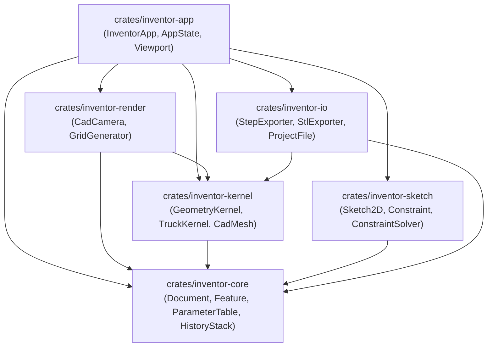

# Rekapitulasi Arsitektur inventor-rs (Berdasarkan CodeGraph)

Dokumen ini merangkum struktur basis kode, relasi simbol, dan graf dependensi dari **`inventor-rs`** yang diekstrak langsung dari indeks CodeGraph (30 berkas terindeks, 280 node simbol, 573 relasi edge).

---

## 1. Ikhtisar Graf Pengetahuan CodeGraph

- **Total Berkas Terindeks**: 30 berkas
- **Node Simbol**: 280 entitas (struct, trait, enum, method, function)
- **Edge Dependensi**: 573 relasi panggilan dan referensi tipe
- **Waktu Parsing & Resolusi**: 466 ms

---

## 2. Struktur Modul & Simbol Kunci

### 2.1 Core Data Model: [`inventor-core`](file:///d:/VSCode/SoftwareDev/crates/inventor-core)
Pusat representasi dokumen part CAD, pohon fitur parametrik, dan status sistem:
- [`Document`](file:///d:/VSCode/SoftwareDev/crates/inventor-core/src/document.rs#L24): Struktur utama penyimpan entitas datum origin (XY Plane, XZ Plane, YZ Plane, sumbu X/Y/Z, titik origin), daftar fitur berurutan, dan tabel parameter.
  - *Caller graph*: Direferensikan langsung oleh [`AppState`](file:///d:/VSCode/SoftwareDev/crates/inventor-app/src/state.rs), [`HistoryStack`](file:///d:/VSCode/SoftwareDev/crates/inventor-core/src/history.rs), dan [`ProjectFile`](file:///d:/VSCode/SoftwareDev/crates/inventor-io/src/project.rs).
- [`Feature`](file:///d:/VSCode/SoftwareDev/crates/inventor-core/src/feature.rs#L39) & [`FeatureKind`](file:///d:/VSCode/SoftwareDev/crates/inventor-core/src/feature.rs#L12): Node hirarki riwayat pemodelan (`Extrude`, `Revolve`, `Fillet`, `Chamfer`, `OriginPlane`, `OriginAxis`, `OriginPoint`).
- [`ParameterTable`](file:///d:/VSCode/SoftwareDev/crates/inventor-core/src/param.rs#L32): Pengelola variabel dimensi bernilai presisi dengan satuan (`Millimeter`, `Degree`, dsb.) dan evaluasi ekspresi matematis.
- [`HistoryStack`](file:///d:/VSCode/SoftwareDev/crates/inventor-core/src/history.rs#L9): Implementasi Command Pattern untuk operasi Undo (`Ctrl+Z`) dan Redo (`Ctrl+Y`).

### 2.2 Kernel Geometri B-Rep: [`inventor-kernel`](file:///d:/VSCode/SoftwareDev/crates/inventor-kernel)
Abstraksi clean-room di atas pustaka B-rep pure-Rust `truck`:
- [`GeometryKernel`](file:///d:/VSCode/SoftwareDev/crates/inventor-kernel/src/traits.rs#L16): Trait abstraksi pemodelan solid 3D (`create_box`, `create_cylinder`, `extrude_polygon`).
- [`TruckKernel`](file:///d:/VSCode/SoftwareDev/crates/inventor-kernel/src/truck_impl.rs#L7): Implementasi konkret memanfaatkan `truck_modeling`, `truck_polymesh`, dan `truck_meshalgo`.
  - Mengonversi B-rep `Solid` ke [`CadMesh`](file:///d:/VSCode/SoftwareDev/crates/inventor-kernel/src/mesh.rs) melalui triangulasi poligon dan ekstraksi boundary wireframe edges.
- [`CadMesh`](file:///d:/VSCode/SoftwareDev/crates/inventor-kernel/src/mesh.rs#L4): Struktur poligon CAD yang memisahkan vertex shaded facet dan feature edge outline.

### 2.3 Sketsa 2D & Solver: [`inventor-sketch`](file:///d:/VSCode/SoftwareDev/crates/inventor-sketch)
Fondasi untuk sketsa berbasis constraint (Milestone 1):
- [`Sketch2D`](file:///d:/VSCode/SoftwareDev/crates/inventor-sketch/src/entity.rs#L64): Wadah entitas 2D (`Point2D`, `Line2D`, `Circle2D`, `Arc2D`).
- [`Constraint`](file:///d:/VSCode/SoftwareDev/crates/inventor-sketch/src/constraint.rs#L25): Relasi geometri (`Horizontal`, `Vertical`, `Coincident`, `Parallel`, `Perpendicular`, `FixPoint`, `Distance`, `Radius`).
- [`ConstraintSolver`](file:///d:/VSCode/SoftwareDev/crates/inventor-sketch/src/solver.rs#L20): Algoritma relaksasi koordinat berbasis residual dan penghitung derajat kebebasan (`calculate_dof`).

### 2.4 Rendering & Kamera 3D: [`inventor-render`](file:///d:/VSCode/SoftwareDev/crates/inventor-render)
Pipeline grafis dan interaksi ruang 3D:
- [`CadCamera`](file:///d:/VSCode/SoftwareDev/crates/inventor-render/src/camera.rs#L10): Kamera orbit CAD yang mendukung rotasi target, panning sejajar bidang pandang, zoom wheel, proyeksi `Perspective` vs `Orthographic`, serta preset orientasi (`Home F6`, `Front`, `Top`, `Right`).
  - [`screen_to_ray`](file:///d:/VSCode/SoftwareDev/crates/inventor-render/src/camera.rs#L137): Mengonversi koordinat kursor 2D ke ray 3D dunia untuk operasi picking.
- [`GridGenerator`](file:///d:/VSCode/SoftwareDev/crates/inventor-render/src/grid.rs#L11): Generator garis lantai grid XZ adaptif dan sumbu koordinat datum XYZ (Merah, Hijau, Biru).

### 2.5 I/O & Format Tukar Data: [`inventor-io`](file:///d:/VSCode/SoftwareDev/crates/inventor-io)
Interoperabilitas CAD standar terbuka:
- [`StepExporter`](file:///d:/VSCode/SoftwareDev/crates/inventor-io/src/step.rs#L13): Pembuat berkas ISO 10303 STEP AP203/214 langsung dari topologi solid B-rep.
- [`StlExporter`](file:///d:/VSCode/SoftwareDev/crates/inventor-io/src/stl.rs#L6): Ekspor mesh STL biner dan ASCII dengan normal per facet.
- [`ProjectFile`](file:///d:/VSCode/SoftwareDev/crates/inventor-io/src/project.rs#L8): Serializer dan deserializer native berbasis JSON terstruktur.

### 2.6 Desktop Application: [`inventor-app`](file:///d:/VSCode/SoftwareDev/crates/inventor-app)
Antarmuka desktop grafis native berbasis `eframe`/`egui`:
- [`InventorApp`](file:///d:/VSCode/SoftwareDev/crates/inventor-app/src/app.rs#L5): Implementasi loop aplikasi `eframe::App` dengan integrasi menu bar, ribbon, panel kiri, dan viewport.
- [`AppState`](file:///d:/VSCode/SoftwareDev/crates/inventor-app/src/state.rs#L26): State terpusat yang menghubungkan dokumen, kamera, kernel, dan dialog aktif.
- [`render_viewport`](file:///d:/VSCode/SoftwareDev/crates/inventor-app/src/ui/viewport.rs#L6): Viewport 3D interaktif dengan Painter's algorithm, shaded diffuse lighting, wireframe edge highlight, dan ViewCube koordinat.
- [`render_ribbon`](file:///d:/VSCode/SoftwareDev/crates/inventor-app/src/ui/ribbon.rs#L5): Ribbon Toolbar tab fungsional (*3D Model*, *Sketch*, *Inspect*, *Tools*, *View*).
- [`render_browser`](file:///d:/VSCode/SoftwareDev/crates/inventor-app/src/ui/browser.rs#L5): Model Browser Tree dengan visibilitas eye toggle untuk origin datums dan fitur.

---

## 3. Jalur Panggilan & Blast Radius (CodeGraph Blast Radius)

1. **Inisialisasi & Siklus Render**:
   - `main.rs` -> instansiasi [`InventorApp`](file:///d:/VSCode/SoftwareDev/crates/inventor-app/src/app.rs#L5) -> `eframe::run_native`.
   - `InventorApp::ui`:
     - Membaca input keyboard (`F6`, `Esc`, `Ctrl+Z`, `Ctrl+Y`).
     - Render [`Panel::top`](file:///d:/VSCode/SoftwareDev/crates/inventor-app/src/app.rs#L44) -> Menu Bar & [`render_ribbon`](file:///d:/VSCode/SoftwareDev/crates/inventor-app/src/ui/ribbon.rs#L5).
     - Render [`Panel::left`](file:///d:/VSCode/SoftwareDev/crates/inventor-app/src/app.rs#L100) -> [`render_browser`](file:///d:/VSCode/SoftwareDev/crates/inventor-app/src/ui/browser.rs#L5).
     - Render [`CentralPanel`](file:///d:/VSCode/SoftwareDev/crates/inventor-app/src/app.rs#L107) -> [`render_viewport`](file:///d:/VSCode/SoftwareDev/crates/inventor-app/src/ui/viewport.rs#L6).
     - Render [`render_dialogs`](file:///d:/VSCode/SoftwareDev/crates/inventor-app/src/ui/dialogs.rs#L7).
     - Render [`render_status_bar`](file:///d:/VSCode/SoftwareDev/crates/inventor-app/src/ui/status_bar.rs#L4).

2. **Pembuatan & Regenerasi Geometri**:
   - Dialog Solid (Box / Cylinder) -> memanggil [`TruckKernel::create_box`](file:///d:/VSCode/SoftwareDev/crates/inventor-kernel/src/truck_impl.rs#L102) -> [`TruckKernel::tessellate_solid`](file:///d:/VSCode/SoftwareDev/crates/inventor-kernel/src/truck_impl.rs#L24).
   - Menambahkan [`Feature`](file:///d:/VSCode/SoftwareDev/crates/inventor-core/src/feature.rs#L39) ke [`Document::add_feature`](file:///d:/VSCode/SoftwareDev/crates/inventor-core/src/document.rs#L79).
   - Mengupdate mesh aktif di [`AppState`](file:///d:/VSCode/SoftwareDev/crates/inventor-app/src/state.rs#L26) -> diproyeksikan langsung di viewport 3D.

---

## 4. Status Verifikasi Pengujian

| Target Test Suite | Hasil Pengujian |
|---|---|
| `inventor-core` | 3 / 3 test lulus (Document, Parameter, History) |
| `inventor-kernel` | 2 / 2 test lulus (Box Primitive, Cylinder Primitive) |
| `inventor-sketch` | 2 / 2 test lulus (Entities, Constraint Solver) |
| `inventor-render` | 2 / 2 test lulus (Grid Generator, Camera Matrices) |
| `inventor-io` | 3 / 3 test lulus (STL ASCII, STL Binary, STEP ISO-10303) |
| **Total** | **12 / 12 Unit Tests Lulus (100% OK)** |
